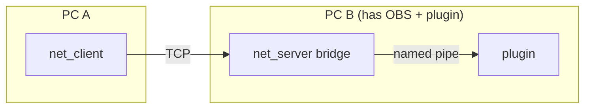

# 2pc-implementation

Experimental two-PC bridge. The OBS plugin runs on **PC B** (the streaming PC) and your application runs on **PC A**. Draw commands travel from PC A to PC B over TCP; on PC B the server translates them into local plugin-pipe commands and the overlay renders on PC B's primary monitor.



The client is a drop-in replacement for the local `obs_overlay::Client` shape API, except it talks to the server instead of the plugin directly. The server opens one plugin connection per incoming session.

## Status

Experimental. No encryption; use on a trusted LAN or tunnel over SSH/VPN. One session at a time per server.

## Protocol

See `shared/net_protocol.h`. Each message is:

```
NetFrameHeader { magic, version, command, payloadSize }
payload bytes
```

Commands mirror a subset of the plugin's shape API (`Clear`, `Rect`, `FilledRect`, `Line`, `Text`, `Present`). A `Hello` is exchanged at the start of the session before anything else.

## Build

Each side builds independently. The server depends on the implementation library (so it can talk to the plugin locally):

```
# on PC B
cmake -S server -B server/build -A x64
cmake --build server/build --config Release

# on PC A
cmake -S client -B client/build -A x64
cmake --build client/build --config Release
```

## Run

```
# PC B (the OBS machine) — leave running
server\build\Release\obs_overlay_net_server.exe --port 51423

# PC A
client\build\Release\obs_overlay_net_client.exe --host 192.168.1.42 --port 51423
```

Flags:

| flag | default | notes |
|------|---------|-------|
| `--host` | `127.0.0.1` | server IP (PC B) |
| `--port` | `51423`     | TCP port |

The client has no way to query the server's overlay dimensions. If you need pixel-perfect placement, add a `GetPluginInfo` round-trip to the protocol.

## Files

- `shared/net_protocol.h` — wire format shared by client and server.
- `server/src/main.cpp` — TCP listener that forwards into the local plugin.
- `client/src/main.cpp` — TCP sender that mirrors the shape API.
