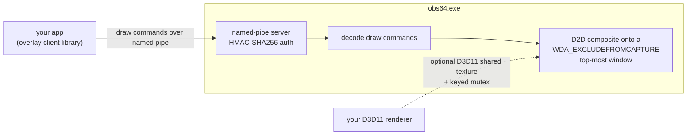

# OBS Overlay

An overlay you can draw on top of your screen while recording/streaming with OBS Studio, **without the overlay ever showing up in the captured video**. The overlay window belongs to `obs64.exe` itself and uses `WDA_EXCLUDEFROMCAPTURE`, so you see it on your desktop but any OBS capture source (Display Capture, Window Capture, Game Capture, Browser Source, NDI, etc.) sees right through it.

Any external C++ application can draw on it over a local named pipe. The included client library also lets you hand it a D3D11 shared texture, so you can render with your own GPU pipeline (ImGui, raw D3D11, whatever) and have OBS composite the result onto the overlay window.

## Pieces

| Folder | What it is |
|--------|------------|
| [`plugin/`](plugin/) | The OBS Studio plugin (DLL). Creates the streamproof window, hosts the named pipe server, composites shapes + a shared texture via D2D on a DirectComposition swap chain. |
| [`implementation/`](implementation/) | A tiny C++ client library (static lib, no D3D11 required) that handles the pipe handshake and exposes a clean shape API. Also launches OBS on demand. |
| [`example/`](example/) | Smallest useful program against the library: connect, draw a rectangle + text, present, hold, clean up. |
| [`Stream Chat example/`](Stream%20Chat%20example/) | A moving fake stream chat drawn on the overlay. You see the chat on your desktop, OBS capture sources don't — so you can keep chat visible without it ending up in the video. |
| [`2pc-implementation/`](2pc-implementation/) | Experimental two-PC bridge. Streams draw commands over TCP from PC A to a server on PC B (the OBS machine), which relays them into the local plugin. Useful when the drawing app and OBS live on different machines. |
| [`release/`](release/) | Pre-built plugin DLL + install script. Drop into `%ProgramData%\obs-studio\plugins\` (or run `install.ps1`) and OBS picks it up. |

## How it works



1. The **plugin** (`plugin/`) is a standard OBS module. When OBS loads, the plugin creates a transparent, click-through, `WDA_EXCLUDEFROMCAPTURE` window covering the primary monitor and starts listening on `\\.\pipe\obs-hidden-chat-overlay`. Anything drawn on this window is visible on your desktop but excluded from every OBS capture source.

2. Your app uses the **implementation library** (`implementation/`) to connect to that pipe. The handshake is a 32-byte random nonce challenged with HMAC-SHA256 — rotate the shared secret in both sides for a real release. Once authenticated, the client sends buffered draw commands (`Rect`, `FilledRect`, `Line`, `Text`) followed by a `Present`. The plugin composites them via Direct2D on a DirectComposition swap chain.

3. For GPU-side rendering, the client asks the plugin for its pid + hwnd + overlay dimensions (`GetPluginInfo`), creates a `BGRA8` D3D11 texture with `SHARED_NTHANDLE | SHARED_KEYEDMUTEX`, `DuplicateHandle`s the shared handle into OBS's process, and sends it via `SharedTexture`. The plugin opens it with `OpenSharedResource1`, wraps it as a D2D bitmap and composites it as the background of each frame. Producer/consumer sync is a two-slot keyed mutex.

4. The **example** (`example/`) is the shortest useful demo: connect, draw, present, in ~30 lines of standard C++.

5. The **stream chat example** (`Stream Chat example/`) is a practical use case: a translucent chat panel scrolling fake messages on the right side of the screen. Swap the fake producer for Twitch IRC / YouTube Live Chat / anything else and you have a hidden chat overlay for streaming.

6. The **2-PC implementation** (`2pc-implementation/`) is for setups where the app that wants to draw lives on a different machine than OBS. Same shape API, but tunneled over TCP; a small server on the OBS PC relays each incoming frame into the local plugin.

## Build

Each piece has its own `CMakeLists.txt` and `README.md`. Short version:

```
# 1. plugin (needs OBS source/SDK)
cmake -S plugin -B plugin/build -A x64 -DLIBOBS_PATH="C:/dev/obs-studio"
cmake --build plugin/build --config RelWithDebInfo

# 2. implementation library + example
cmake -S example -B example/build -A x64
cmake --build example/build --config Release

# 3. stream chat example (folder name has spaces — keep the quotes)
cmake -S "Stream Chat example" -B "Stream Chat example/build" -A x64
cmake --build "Stream Chat example/build" --config Release

# 4. (optional) 2-PC bridge
cmake -S 2pc-implementation/server -B 2pc-implementation/server/build -A x64
cmake -S 2pc-implementation/client -B 2pc-implementation/client/build -A x64
cmake --build 2pc-implementation/server/build --config Release
cmake --build 2pc-implementation/client/build --config Release
```

## Install

Copy the plugin DLL and its data folder under the OBS plugin root:

```
%ProgramData%\obs-studio\plugins\obs-hidden-chat-overlay\bin\64bit\obs-hidden-chat-overlay.dll
%ProgramData%\obs-studio\plugins\obs-hidden-chat-overlay\data\locale\en-US.ini
```

Launch OBS. Look for a `[obs-hidden-chat-overlay] loaded` line in `Help > Log Files > View Current Log` and verify the plugin is listed.

## Requirements

- Windows 10 version 1809 or newer (for `WDA_EXCLUDEFROMCAPTURE`, `SHARED_NTHANDLE`, `IDXGIResource1::CreateSharedHandle`).
- OBS Studio installed on whichever machine runs the plugin.
- MSVC 2022 or newer, CMake 3.16+.

## Verifying the capture exclusion

With the overlay drawn on screen, start an OBS recording using a Display Capture source. Stop the recording and play it back — the overlay must not appear in the video. If it does, `WDA_EXCLUDEFROMCAPTURE` isn't being applied; re-check the plugin log and that you're on Windows 10 1809+.

## Shared secret

Both the plugin and the client library embed a 32-byte handshake secret (`kSharedSecret`). They must match byte for byte. For a real release, generate a fresh 32-byte random value and rotate both sides together.
"# OBS-Overlay-" 
