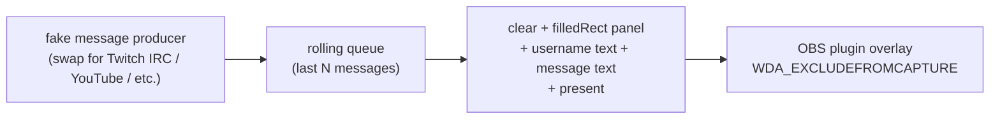

# Stream Chat example

A moving fake stream chat drawn on the OBS overlay window. **You** see the chat on top of everything on your desktop; your OBS capture sources don't — so you can keep the chat visible while streaming/recording without it ending up inside the video.



## What this is

- Connects to the plugin through the implementation library.
- Holds a rolling window of the last ~18 messages.
- Pushes a fake message onto the queue every 350–1600 ms, randomized.
- Each frame: clears, draws the panel + title bar + border, draws every message (colored username + white text), presents.
- Runs for 60 seconds, then clears the overlay and exits.

## Why fake messages

Keeps the example self-contained — no OAuth, no API keys, nothing to configure. Build and run.

## Wiring a real chat source

Replace `makeFakeMessage()` with a producer thread that:

1. Connects to your chat source (e.g. Twitch IRC on `tmi.twitch.tv:6667`, YouTube Live Streaming API, Kick, a websocket).
2. Parses incoming messages and pushes them onto a thread-safe queue.
3. The main loop drains the queue each frame instead of generating fake entries.

Everything else — the panel, the layout, the drawing calls — stays as-is.

## Build

Depends on the static library in `../implementation`.

```
cmake -S . -B build -A x64
cmake --build build --config Release
```

Binary: `build\Release\obs_overlay_stream_chat_example.exe`.

The folder name has spaces, so if you're copy-pasting a path into CMake quote it: `cmake -S "Stream Chat example" -B ...`.

## Run

Plugin must be installed and OBS available. The example launches OBS minimized to tray if it isn't already running.

```
build\Release\obs_overlay_stream_chat_example.exe
```

You should see a translucent dark panel on the right side of the primary monitor with messages rolling in. If you capture the screen in OBS (Display Capture / Game Capture / Window Capture) the panel isn't present in the capture.

## Notes

- Username/message inline layout uses a rough proportional-font advance estimate (`~0.52 × fontSize` per char). It lines up fine for an example; use DirectWrite `GetMetrics()` on your side if you want pixel-perfect spacing.
- Maximum visible lines, panel width, panel position, title string — all top-of-file constants in `src/main.cpp`.
